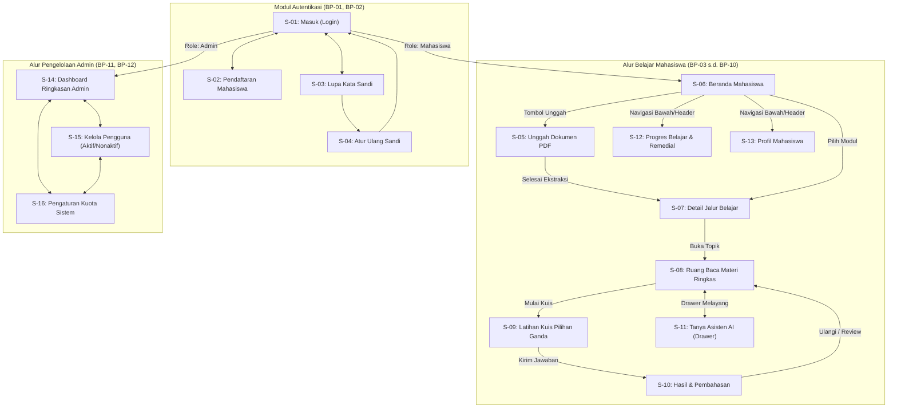

# DRAF LAPORAN KEMAJUAN TUGAS 2 (CAPSTONE STSI4440)
## BAB III: METODOLOGI DAN PERANCANGAN SISTEM
### Subbab: Perancangan Antarmuka Pengguna (UI/UX) dan Alur Layar
**PIC Tanggung Jawab**: Latif Muhith W (NIM: 51316387 — Peran: UI/UX + Frontend)

---

### 3.X Perancangan Antarmuka Pengguna (UI/UX)

Perancangan antarmuka pengguna pada aplikasi *Pahami* berfokus pada kemudahan belajar mandiri bagi mahasiswa Universitas Terbuka yang membaca Buku Materi Pokok (BMP) secara intensif. Pendekatan perancangan menerapkan prinsip *User-Centered Design* (UCD) berbasis standar **Google Material Design 3 (M3)** dengan skema adaptif *Light/Dark Mode* dan tata letak *Mobile-First Responsive*.

#### 3.X.1 Pedoman Desain dan Sistem Desain (*Design System*)

Untuk menjamin konsistensi visual di seluruh modul aplikasi, sistem antarmuka dibangun di atas token desain yang baku:

1. **Palet Warna (Tema Opsi A: Hijau Teal / *Deep Teal*)**:
   - Dipilih warna dasar (*Seed Color*) Hijau Teal `#1F6F5C` yang merepresentasikan identitas akademis Universitas Terbuka yang teduh, profesional, dan nyaman di mata untuk sesi belajar berdurasi lama (*low eye-strain*).
   - **Mode Gelap (*Dark Theme - Default*)**:
     - *Primary*: `#5EDBBB` (Aksen utama mint segar)
     - *On-Primary*: `#00382C` (Teks kontras di atas tombol utama)
     - *Primary Container*: `#005141`
     - *Surface / Background*: `#191C1B` (Permukaan gelap nyaman)
     - *Surface Container*: `#232725` (Latar kartu dan kontainer)
     - *Error Container*: `#93000A` (Indikator gagal/remedial)
   - **Mode Terang (*Light Theme*)**:
     - *Primary*: `#006B57` (Hijau botol klasik)
     - *On-Primary*: `#FFFFFF` (Teks putih)
     - *Surface*: `#FBFDFA`
     - *Surface Container*: `#EDF1EC`
   - **Rasio Kontras**: Seluruh kombinasi teks dan latar memenuhi standar aksesibilitas WCAG 2.1 level AA (kontras minimum 4.5:1 untuk teks normal dan 7:1 untuk teks tebal).

2. **Tipografi (*Typography Scale*)**:
   - Menggunakan rupa huruf **Plus Jakarta Sans** yang memiliki keterbacaan tinggi (*high legibility*) baik pada layar ponsel cerdas beresolusi kecil maupun monitor desktop.
   - Hirarki tipografi mencakup:
     - *Title Large / H1*: 24px–32px, *Bold*, *Tracking-tight* (Judul layar utama)
     - *Title Medium / H2*: 16px–20px, *Semi-Bold* (Judul seksi/kartu modul)
     - *Body Medium*: 14px, *Regular*, *Leading-relaxed* (Teks materi dan bacaan ringkas)
     - *Label & Mono*: 11px–12px, *Font-Mono* (Metadata halaman, skor kuis, dan kuota)

3. **Komponen Interaktif Standar**:
   - *Target Sentuh Ramah Pengguna*: Seluruh tombol dan area klik memiliki tinggi minimum 44px–48px (`min-h-11` hingga `min-h-12`) sesuai standar interaksi sentuh *mobile-first*.
   - *Bentuk Sudut (*Corner Radius*)*: Menggunakan radius lengkung halus M3 (*Full Pill* 9999px untuk tombol aksi utama; 16px–24px untuk kartu dan modal dialog).

---

#### 3.X.2 Diagram Alur Antarmuka Pengguna (*Wireflow & Screen Navigation*)

Alur antarmuka aplikasi terbagi menjadi dua ranah peran utama: **Alur Mahasiswa** dan **Alur Administrator**.

---

#### 3.X.3 Rincian Rancangan 16 Layar Antarmuka (*Screen Specifications*)

Berikut adalah uraian spesifikasi perancangan visual dan tata letak untuk seluruh 16 layar aplikasi *Pahami*:

##### 1. Layar S-01: Masuk (*Login*)
- **Fungsi**: Gerbang masuk mahasiswa dan administrator ke dalam sistem (BP-01).
- **Elemen Antarmuka**: Logo Universitas Terbuka, *Header* selamat datang, kolom input email institusi/umum (BR-18), kolom kata sandi dengan tombol *toggle visibility* mata, tombol Masuk utama (*pill shape*), tautan Lupa Sandi, dan tautan Daftar Akun Baru.
- **Validasi Visual**: Menampilkan pesan kesalahan instan `MSG-V01` dan `MSG-V02` jika kredensial tidak cocok atau akun nonaktif (`BR-23`).

##### 2. Layar S-02: Pendaftaran Mahasiswa Baru (*Register*)
- **Fungsi**: Formulir registrasi akun mandiri mahasiswa (BP-01).
- **Elemen Antarmuka**: Input nama lengkap (3–60 karakter, `BR-22`), input email, input kata sandi (minimal 8 karakter kombinasi huruf & angka, `BR-22`), dan konfirmasi sandi. Terdapat ceklist indikator kekuatan kata sandi secara *real-time*.

##### 3. Layar S-03 & S-04: Lupa dan Atur Ulang Kata Sandi
- **Fungsi**: Pemulihan akun mandiri melalui pengiriman token verifikasi email (BP-02).
- **Elemen Antarmuka**: Input email terdaftar pada S-03, diikuti layar S-04 untuk memasukkan token 6 digit dan kata sandi baru.

##### 4. Layar S-05: Unggah Dokumen Modul BMP UT
- **Fungsi**: Pengunggahan berkas modul kuliah digital dalam format PDF (BP-03).
- **Elemen Antarmuka**:
  - *Drag-and-Drop Area* interaktif dengan batas garis putus-putus.
  - Kartu pemantau kuota dokumen terpakai (`X / 5 Dokumen`, `BR-04`).
  - Indikator progres ekstraksi 5 tahap (*stepper*) animasi: validasi format, ekstraksi halaman (`BR-06`), pengenalan daftar isi, pembagian topik/kegiatan belajar (`BR-07`), dan pembuatan indeks AI.
  - Proteksi penolakan jika berkas non-PDF (`MSG-U01`), melebihi batas MB (`MSG-U02`), atau scan gambar tanpa teks (`MSG-U07`).

##### 5. Layar S-06: Beranda Mahasiswa (*Dashboard*)
- **Fungsi**: Pusat navigasi dan pemantauan aktivitas belajar mahasiswa (BP-04).
- **Elemen Antarmuka**:
  - Salam personalisasi (*"Halo, [Nama Mahasiswa]"*).
  - Tiga kartu ringkasan metrik: Modul Aktif, Topik Tuntas, dan Rata-rata Nilai.
  - Kartu *"Lanjutkan Belajar"* dinamis yang merekam kegiatan belajar terakhir (`BR-34`).
  - Daftar berkas dokumen modul dengan menu elipsis aksi (*Rename* `BR-21`, *Delete* konfirmasi modal, dan unduh).

##### 6. Layar S-07: Detail Dokumen & Jalur Belajar (*Learning Path*)
- **Fungsi**: Visualisasi kegiatan belajar per modul dalam bentuk daftar sekuensial (BP-04).
- **Elemen Antarmuka**:
  - Kartu informasi modul: judul, jumlah halaman, dan estimasi waktu baca.
  - Badge status per topik (`BR-13`): *Belum Dipelajari*, *Selesai* (Lulus $\ge 70$), atau *Perlu Penguatan* (Remedial).
  - Rekomendasi topik prioritas dengan penanda lencana *"Disarankan"* (`BR-35`).

##### 7. Layar S-08: Ruang Belajar (*Learning Room*)
- **Fungsi**: Antarmuka membaca ringkasan materi hasil ekstraksi AI (BP-05).
- **Elemen Antarmuka**:
  - Panel baca terfokus (*Zen reader*) dengan ukuran teks proporsional.
  - Poin-poin inti materi (*Key Takeaways*), kata kunci penting (*Keywords Chip*), dan contoh penerapan konsep.
  - Tombol melayang (*Floating Action Button*) untuk memanggil asisten Tanya AI (`S-11`).
  - Tombol transisi di bagian bawah: *"Lanjut ke Latihan Soal"*.

##### 8. Layar S-09 & S-10: Latihan Soal & Pembahasan Kuis
- **Fungsi**: Evaluasi pemahaman mandiri mahasiswa berbasis kuis pilihan ganda (BP-06).
- **Elemen Antarmuka (S-09)**: Indikator nomor soal aktif, bilah progres pengerjaan, kartu pertanyaan, 4 opsi pilihan ganda dengan efek *hover/selected*, dan proteksi konfirmasi keluar `MSG-L03`.
- **Elemen Antarmuka (S-10)**: Skor akhir kuis (0–100), status kelulusan (Batas tuntas KKM 70, `BR-13`), umpan balik apresiasi `MSG-L04/L05/L06`, serta kartu pembahasan kunci jawaban lengkap dengan alasan penjelasan konsep.

##### 9. Layar S-11: Tanya Asisten AI Modul (*Grounded AI Chat*)
- **Fungsi**: Konsultasi tanya-jawab cerdas berbasis dokumen BMP yang sedang dipelajari (BP-07).
- **Elemen Antarmuka**: *Drawer* sisi kanan (desktop) atau *Bottom-sheet* (mobile) yang dapat dibuka-tutup tanpa meninggalkan teks modul. Menampilkan kutipan nomor halaman rujukan (*source attribution*), riwayat obrolan sesi, dan pembatasan kuota harian `MSG-C02` (`BR-26`).

##### 10. Layar S-12: Progres Belajar Mahasiswa
- **Fungsi**: Dasbor analitik kemajuan belajar dan monitoring remedial (BP-08).
- **Elemen Antarmuka**:
  - Dropdown pemilih modul yang telah diunggah.
  - Grafik batang horizontal skor per kegiatan belajar dilengkapi penanda garis vertikal batas KKM 70 (`| Batas Tuntas (KKM): Skor 70`).
  - Bagian khusus *"Perlu Penguatan"*: menampilkan topik-topik bernilai $< 70$ disertai tombol tindakan cepat *"Baca Ulang"* dan *"Ulangi Latihan"*.
  - Riwayat 10 sesi pengerjaan kuis terakhir dengan tanggal dan perolehan nilai.

##### 11. Layar S-13: Profil Pengguna
- **Fungsi**: Manajemen data diri, ubah kata sandi, dan pemantauan kuota akun (BP-09, BP-10).
- **Elemen Antarmuka**: Formulir nama lengkap (`BR-22`), alamat email *read-only* institusi (`BR-36`), formulir pembaruan kata sandi, bilah meteran kapasitas penyimpanan modul (`BR-04`), dan informasi peran akun.

##### 12. Layar S-14: Dashboard Ringkasan Administrator
- **Fungsi**: Pusat kendali dan pengawasan operasional sistem untuk Admin UT (BP-11).
- **Elemen Antarmuka**:
  - Filter rentang waktu statistik (7 hari vs 30 hari terakhir).
  - 4 Kartu KPI: Total Mahasiswa Terdaftar, Total Dokumen Diunggah, Volume Pertanyaan AI, dan Estimasi Biaya Komputasi AI (`BR-27`).
  - Grafik batang visualisasi tren pertanyaan AI per hari.
  - Tabel pratinjau 5 pendaftar mahasiswa terbaru dengan tautan cepat ke Layar S-15.

##### 13. Layar S-15: Pengelolaan Pengguna Administrator
- **Fungsi**: Manajemen akun mahasiswa terdaftar dan moderasi status akses (BP-11).
- **Elemen Antarmuka**:
  - Bilah pencarian instan berdasarkan nama atau email.
  - Tab filter status berkontras tinggi: **Semua**, **Aktif**, dan **Nonaktif** lengkap dengan lencana penghitung jumlah pengguna.
  - Tabel responsif (desktop) dan kartu vertikal (mobile).
  - Tombol aksi nonaktifkan akun mahasiswa yang memunculkan modal konfirmasi `MSG-M01` (`BR-23`), dengan proteksi kekebalan akun Admin yang terkunci permanen (`BR-24`).

##### 14. Layar S-16: Pengaturan Kuota & Parameter Sistem Administrator
- **Fungsi**: Konfigurasi batasan kuota operasional aplikasi secara dinamis (BP-12).
- **Elemen Antarmuka**:
  - Kontrol ganda *Slider* dan input numerik untuk 5 parameter sistem (`BR-29`):
    1. Kuota Dokumen: 1–50 dokumen *(Default: 5)*
    2. Maksimal Ukuran File: 5–100 MB *(Default: 25 MB)*
    3. Maksimal Halaman PDF: 10–1.000 halaman *(Default: 100)*
    4. Batas Harian Tanya AI: 10–200 pertanyaan/hari *(Default: 50)*
    5. Batas KKM Kelulusan Kuis: skor 50–90 *(Default: 70)*
  - Tombol *"Reset ke Default UT"* untuk memulihkan konfigurasi awal.
  - Tombol simpan perubahan dengan umpan balik notifikasi resmi katalog `MSG-S01`.

---

#### 3.X.4 Daftar Gambar Mockup Antarmuka (Untuk Lampiran Laporan)

Berikut adalah panduan penempatan tangkapan layar antarmuka aplikasi *Pahami* yang telah diimplementasikan:

- **Gambar 3.1**: Mockup Layar S-01 (Masuk) dan S-02 (Pendaftaran Mahasiswa Baru)
- **Gambar 3.2**: Mockup Layar S-05 (Pengunggahan Modul BMP UT dan Tahap Ekstraksi)
- **Gambar 3.3**: Mockup Layar S-06 (Beranda Mahasiswa dan Pemantauan Modul Aktif)
- **Gambar 3.4**: Mockup Layar S-07 (Detail Jalur Belajar Modul dan Status Kelulusan Topik)
- **Gambar 3.5**: Mockup Layar S-08 (Ruang Belajar Ringkasan Materi) dan S-11 (Drawer Tanya AI)
- **Gambar 3.6**: Mockup Layar S-09 (Kuis Pilihan Ganda) dan S-10 (Hasil & Pembahasan Soal)
- **Gambar 3.7**: Mockup Layar S-12 (Analitik Progres Belajar, Garis KKM 70, dan Remedial)
- **Gambar 3.8**: Mockup Layar S-13 (Profil Pengguna dan Meteran Kuota Dokumen)
- **Gambar 3.9**: Mockup Layar S-14 (Dashboard Ringkasan Admin dan Estimasi Biaya AI)
- **Gambar 3.10**: Mockup Layar S-15 (Kelola Pengguna, Filter Status, dan Dialog Nonaktifkan Akun)
- **Gambar 3.11**: Mockup Layar S-16 (Pengaturan Kuota Sistem dan Parameter Operasional)
